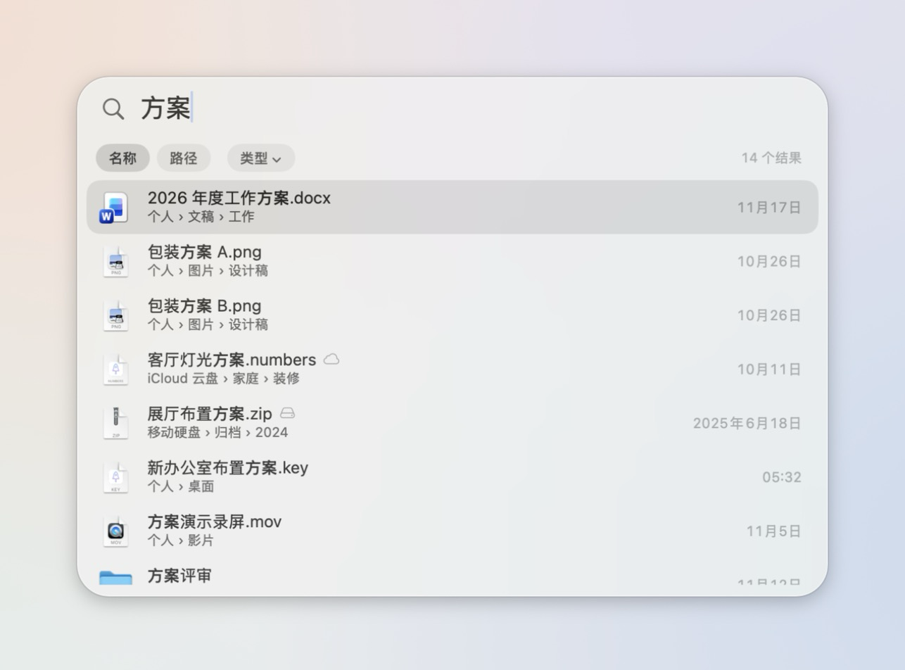
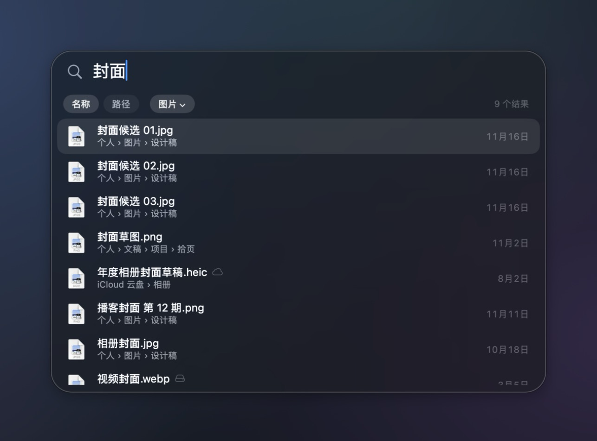
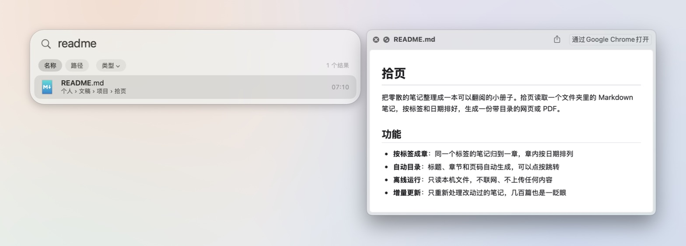
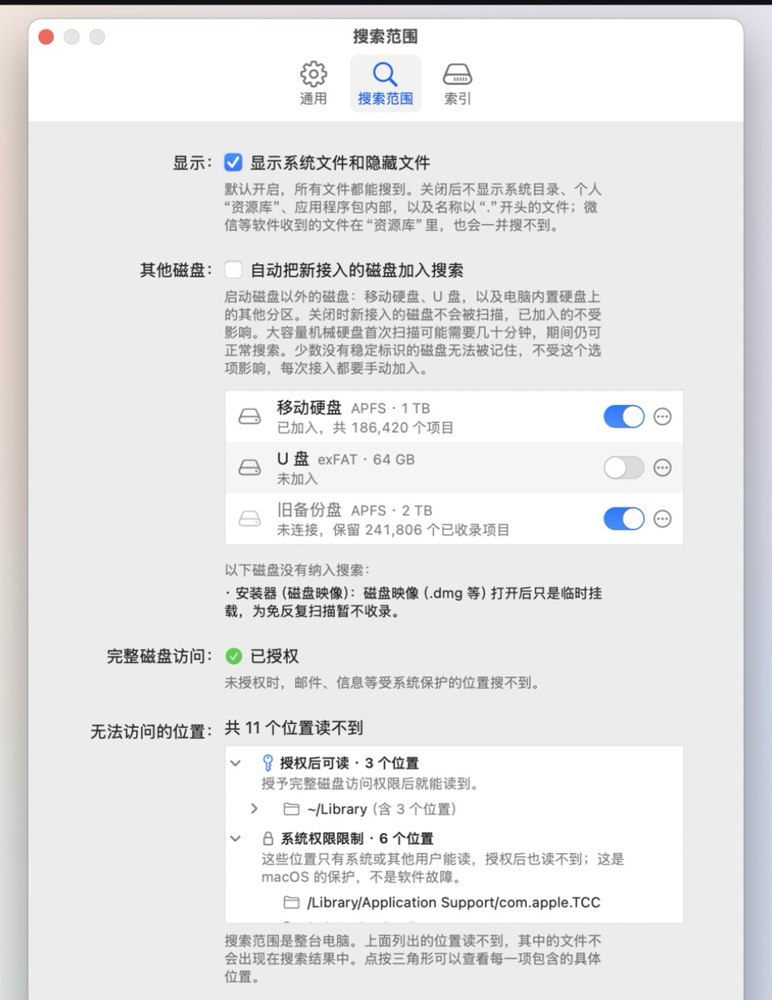
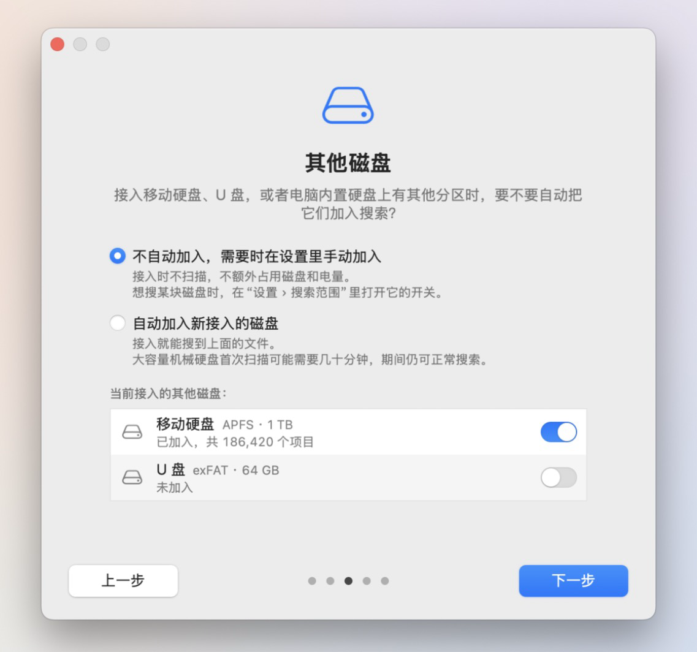

<p align="center"><a href="README.md">简体中文</a> | English</p>

<p align="center">
  
</p>

<h1 align="center">Suoyin (索隐)</h1>

<p align="center">File name search for the Mac. Press a shortcut, type one character, and results from over two million files are already there.</p>

<p align="center">
  <a href="https://github.com/nongtanpeidanjiu/suoyin/releases/latest">Download the latest release</a>
  ·
  <a href="docs/安装说明.md">Installation guide (in Chinese)</a>
  ·
  <a href="PRIVACY.md">Privacy notes (in Chinese)</a>
  ·
  <a href="#building-from-source">Building from source</a>
</p>



<p align="center"><sub>Searching for “方案” (plan). The results include files on this Mac, files in iCloud Drive that haven't been downloaded yet (with a cloud icon), and files on an external drive (with a disk badge).</sub></p>

The name comes from a line in the Book of Changes (《周易·系辞上》): “探赜索隐，钩深致远”, which roughly means seeking out what is hidden and reaching what lies deep and far. In Chinese it also sounds exactly like 索引, the word for “index.” Those two characters are what I want it to do: find things even when they're tucked away.

## Why I made this

I often remember only half a word of a file's name. What I want is to press a shortcut, type a few characters, and see right away where the file is. And it has to find the file wherever it's hiding, including dotfiles, things deep in my personal Library folder, and the insides of app bundles. Files I receive in chat apps get stored very deep in the Library. I remember the name perfectly well, but clicking down through Finder one folder at a time is a pain.

So I wrote Suoyin. It does one thing: find files by name and path. It builds its own index by reading the file system directly and watching for changes, and it doesn't read or depend on Spotlight's index. Hidden files and system folders are all searchable by default. Where the system really won't let it read, it lists those places one by one for you instead of quietly skipping them.

## How fast it actually is

The numbers below come from acceptance tests during development. The test machine is an Apple M2 Mac with 8 GB of memory running macOS 15.7.9. How each number was measured and where it comes from is written up in [Test conditions](#test-conditions) at the end. What's measured is the search core itself (running as a command-line process); the interface is counted separately.

On a full-disk index holding 2,183,275 files and folders, 95% of searches by name return within 9.8 ms, and searches by full path within 13.7 ms.<sup>[1]</sup> Every character you type into the search field refreshes the results.

When a file is created, renamed or deleted, the change shows up in the results in about a second. The P95 for all three operations is within 1.05 seconds, and changes inside hidden folders behave the same way.<sup>[2]</sup>

It stays in the menu bar. When no files are changing, it averages 0.0073% of a single core. With the everyday background file activity a Mac has, three-minute averages ranged from 0.043% to 0.888%.<sup>[3]</sup> The whole two-million-scale index is kept in memory, and I measured the process's physical memory footprint at 135 to 155 MB. For the second or two when it merges incremental changes into the index in the background, that briefly rises to around 260 MB and then drops back.<sup>[4]</sup>

The first index build took 17.87 seconds for about 1.93 million entries on the test machine, and whatever has already been indexed is searchable while it runs. On later launches, the existing index is usable in about 0.1 seconds.<sup>[5]</sup>

## What it does

By default, <kbd>⌥ Option</kbd> + <kbd>⇧ Shift</kbd> + <kbd>Space</kbd> brings up the search panel from anywhere, and pressing it again hides the panel. You can change the shortcut, and while you're recording a new one it checks whether it conflicts with system shortcuts or with keys the panel uses.

Type a few words separated by spaces. Every word has to appear in the file name, in any order. Press <kbd>Tab</kbd> to switch to Path (路径) mode, where words can match a folder at any level: “质量 2026” finds files with “2026” in their names inside a folder called “质量” (quality), and you can also type a piece of a path containing “/” directly. You can filter by type as well: folders (文件夹), documents (文稿), images (图片), audio (音频), video (视频), archives (压缩包) and applications (应用程序), switching with <kbd>⌘1</kbd> to <kbd>⌘8</kbd>.



<p align="center"><sub>Searching for “封面” (cover) in dark mode, then pressing ⌘4 to show only images.</sub></p>

Result rows use each file's real icon, and the location is written like “个人 › 文稿 › 项目” (Home › Documents › Project), using the same names Finder does. However long a name is, it takes up a single line, shortened in the middle so the extension is always visible.

| Key | Action |
|---|---|
| <kbd>Return</kbd> or double-click | Open the file |
| <kbd>⌘</kbd> + <kbd>Return</kbd> | Show in Finder |
| <kbd>⌥</kbd> + <kbd>Space</kbd> or <kbd>⌘Y</kbd> | Quick Look preview |
| <kbd>⌘C</kbd> | Copy the full path |
| <kbd>Tab</kbd> | Switch between name and path |
| <kbd>⌘1</kbd> to <kbd>⌘8</kbd> | Switch file type |
| <kbd>Esc</kbd> | Clear the input; press again to hide the panel |

You can also drag result rows straight into other apps.

The preview window sits to the right of the panel. Move up or down a row with the arrow keys and the preview follows. For text files the system only shows an icon for, such as Markdown, YAML, all sorts of config files and subtitles, I made it show the contents directly, and Markdown gets its headings, lists and tables laid out. Chinese text in GB (国标) encodings displays correctly too.



<p align="center"><sub>Searching for “readme” and pressing ⌥ Space. On the right is the formatted Markdown, without opening the file.</sub></p>

Files in iCloud Drive and other cloud drives that haven't been downloaded to the Mac can still be found by name, and searching doesn't trigger a download.<sup>[6]</sup> External drives, USB flash drives and other partitions on the internal disk can be added to search if you want. When one is unplugged, its results are removed right away, and the data already indexed stays on the Mac. If you quit halfway through a scan, it picks up where it left off next time. On a USB hard disk drive I measured about a thousand entries indexed per second, and you can keep searching what's already indexed while the scan runs.<sup>[7]</sup>

Every location it can't read is listed in Settings › Search Scope (设置 › 搜索范围), grouped into “readable once authorized” (授权后可读), “restricted by system permissions” (系统权限限制) and “unknown reason” (原因不明), with system folders listed as well. I tested it once without Full Disk Access, and it listed 341 locations.<sup>[8]</sup> Apart from Suoyin's own index data, it doesn't exclude any location on its own initiative. If system files feel like too much clutter, you can turn off “Show system and hidden files” (显示系统文件和隐藏文件) on the same page.



<p align="center"><sub>Settings › Search Scope: switches for other disks at the top, the list of unreadable locations below.</sub></p>

The first time you open it, a five-step setup assistant explains which permissions it needs, whether other disks such as external drives should be added automatically, and which shortcut to use. Every step can be skipped. The interface follows the system's light and dark mode.



<p align="center"><sub>Step three of the setup assistant: whether other disks you connect should be added to search automatically.</sub></p>

## What it can't do yet

- It isn't notarized by Apple. I haven't paid to register an Apple developer account, so the first time you open it the system blocks it, and you have to allow it once by hand in Privacy & Security. The steps are in the [installation guide](docs/安装说明.md) (in Chinese).
- It searches file names and paths only, not file contents.
- Full-width and half-width Latin letters and digits aren't treated as the same character yet, so searching for “ABC” won't find a file whose name contains the full-width “ＡＢＣ”. Upper and lower case don't matter.
- The index file isn't encrypted. It lives in your home folder and records the file names of the whole disk, so other software running as you can read it. See the [privacy notes](PRIVACY.md) (in Chinese) for details.
- The interface is in Simplified Chinese only.
- Disk images (.dmg and so on) and network volumes aren't indexed for now, and Settings says which disks aren't included.
- It only supports Macs with Apple silicon. All measurements were done on macOS 15.7.9, and newer versions of macOS haven't been checked item by item yet.

## Installation

You need a Mac with Apple silicon running macOS 15.7.9 or later.

1. Download the .dmg from the [releases page](https://github.com/nongtanpeidanjiu/suoyin/releases/latest), open it, and drag 索隐 into Applications.
2. When the system blocks it the first time you open it, go to System Settings › Privacy & Security and click Open Anyway.
3. Grant Full Disk Access as the setup assistant guides you, or skip it for now.

Exactly where to click at each step, how to check that the file you downloaded hasn't been altered, and how to uninstall completely are all in the [installation guide](docs/安装说明.md) (in Chinese).

## Full Disk Access

macOS protects places like Mail, Messages, Safari data and other apps' data folders. Without authorization, the file names inside them can't be read. Once you grant access, Suoyin uses it to read the names, sizes and modification dates of files and folders to build the index. It reads a file's contents only when you choose to preview that particular file. It doesn't modify, move or delete any file.

To check whether access has been granted, I try to open a system file that can only be opened with that access, then close it right away without reading what's inside.<sup>[9]</sup>

It works without the permission too, just with a smaller search scope. So that the system's “would like to access…” prompt doesn't pop up before you've even seen the explanation, Suoyin leaves other apps' data folders alone until you grant access, and fills them in after that.

## Privacy

The index records only file names, sizes and modification dates, and it's kept in the Application Support folder inside your personal Library. When it previews certain text files, the temporary copies it makes go in the Caches folder, readable only by your account, and are deleted when the preview closes. Suoyin doesn't collect usage data and doesn't upload anything. The only reason it goes online is to check for updates. The details are in the [privacy notes](PRIVACY.md) (in Chinese).

## Automatic updates

Release builds use the open-source Sparkle framework for automatic updates. By default it checks the update feed on this project's GitHub releases page once a day. The request carries no user or machine identifier and doesn't send system information. Updates are signed with my private key, the app has the matching public key built in, and if the signature doesn't match, the update isn't installed.

In Settings › General › Updates (设置 › 通用 › 更新) you can turn off automatic checks, and you can choose how updates are handled: download and install automatically, download automatically and ask you before installing (the default), or just let you know there's a new version.

## FAQ

**Does it conflict with Spotlight?**
No, you can use both. Suoyin doesn't read or depend on Spotlight's index, so whether Spotlight is on or off makes no difference to it.

**How much disk space does the index take?**
On the test machine, with about 1.95 million entries, the index files came to about 106 MB.<sup>[10]</sup> You can see the current size on the Settings › Index (设置 › 索引) page.

**What should I do if a file doesn't show up?**
First check whether “Show system and hidden files” (显示系统文件和隐藏文件) has been turned off in Settings › Search Scope (设置 › 搜索范围). Then see whether the file is in the “Inaccessible locations” (无法访问的位置) list, or on a disk that hasn't been added to search yet.

**Why does the system block it the first time I open it?**
Because it isn't notarized by Apple, and the system blocks every un-notarized app once. The reason and the steps to allow it are in the [installation guide](docs/安装说明.md#为什么会被拦) (in Chinese).

**Can I use it commercially?**
No. See the license below.

## Building from source

You don't need Xcode. Installing the Command Line Tools (`xcode-select --install`) is enough. I develop and test with Swift 6.1.2.

```sh
git clone https://github.com/nongtanpeidanjiu/suoyin.git
cd suoyin

# Search core and command-line tool
swift build -c release

# Automated tests
swift test -c release --disable-xctest --enable-swift-testing

# Package as an app (preview build, display name “索隐（预览）”, output at App/.build/FileSearchDemo.app)
App/Tools/bundle.sh

# Run the interface with demo data, without reading your disk
cd App && swift run SearchApp --demo
```

The first time the interface project builds, it downloads Sparkle's prebuilt framework from GitHub, so you need to be online. The system ties Full Disk Access to the app's signature. When the bundling script can't find a fixed signing certificate, it falls back to an ad-hoc signature, and then you may have to grant access again every time you rebuild. `bundle.sh --release` is what I use to build releases. It needs the signing certificate and update key on my own machine, so if anyone else runs it, it exits with an error straight away.

The code layout and how to contribute are described in [CONTRIBUTING.md](CONTRIBUTING.md) (in Chinese).

## License

Suoyin is released under the [PolyForm Noncommercial License 1.0.0](LICENSE). You can read the source, modify it and use it yourself, and you can share the original or a modified version for noncommercial purposes, as long as you include the license and the copyright notice. No commercial use of any kind is allowed.

This is not an open-source license. The source is public and you can modify it, but its use is restricted, so it doesn't meet the definition of open source. If you'd like to use it commercially, please contact me first about a separate license.

## Acknowledgments

Automatic updates use [Sparkle](https://sparkle-project.org/) (MIT license), and the license text comes from the [PolyForm Project](https://polyformproject.org/). Everything else uses only the system frameworks that come with macOS, and the small icons in the interface are Apple's system symbols. The full list is in [THIRD-PARTY.md](THIRD-PARTY.md) (in Chinese).

---

## Test conditions

Unless noted otherwise, everything was measured on the same Apple M2 Mac with 8 GB of memory running macOS 15.7.9. The subject is the search core (running as a command-line process, with the interface counted separately), and the index covers everything on that machine's startup disk that was readable at the time. P95 means 95% of requests took no longer than that. MB means 1,000,000 bytes.

1. Search latency: 2,183,275 entries indexed, with “Show all” (显示全部) turned on, each request fetching the first screen of 50 results and computing the total count. 200 requests each for name and path, covering high-hit, rare, zero-hit, cross-folder and multi-keyword queries, rotating through four sort orders. Name P95 9.825 ms, path P95 13.685 ms. Source: [Milestone 4 engine API acceptance](docs/里程碑4-门面验收.md) (in Chinese), section “自动化与实机” (automated and real-machine). With type filtering, 100 requests for each of the eight types, P95 between 6.565 and 14.494 ms; see section “任务单 15 · 最终自动化与真机数据” (task 15, final automated and real-machine data) in the same document.
2. Change to searchable: using real file system events in a test folder, creation, renaming and deletion were each measured 12 times, checking about every 25 ms. P95 was 1,049.99, 1,051.17 and 1,043.07 ms respectively. Source: [Milestone 2 resource usage acceptance](docs/里程碑2-占用专项验收.md) (in Chinese), section “任务单 24 · 文件变化到可搜” (task 24, file change to searchable). Inside hidden folders, P95 for creation, renaming and deletion was 1.025, 1.029 and 1.021 seconds. Source: [Milestone 4 engine API acceptance](docs/里程碑4-门面验收.md) (in Chinese), section “任务单 26 · 新建、改名和删除的命中延迟” (task 26, hit latency for creation, renaming and deletion).
3. CPU: in a 180-second window with no file changes, average 0.0073% of a single core. Source: the quiet baseline in [Milestone 2 resource usage acceptance](docs/里程碑2-占用专项验收.md) (in Chinese), section “任务单 24 · 180 秒真实全盘监听” (task 24, 180 seconds of real full-disk watching). In three-minute full-disk watching runs with real background file activity, the per-run averages were 0.043% to 0.888% of a single core. Source: [Milestone 4 engine API acceptance](docs/里程碑4-门面验收.md) (in Chinese), section “三分钟监听” (three-minute watching) and the watching tables under task 13 (任务单 13) and task 15 (任务单 15). It goes higher when lots of files change at once: one three-minute window that received 8,956 file events and triggered one index merge averaged 2.180% of a single core; see [Milestone 2 resource usage acceptance](docs/里程碑2-占用专项验收.md) (in Chinese), section “任务单 24 · 合并峰值专项” (task 24, merge peak).
4. Memory: in the three-minute watching runs above, the process's peak physical memory footprint was 134.678 to 154.601 MB, from the same Milestone 4 tables as item 3. One measured peak during a background merge was 258.92 MB, falling back to 124.45 MB after about 1.4 seconds; see [Milestone 2 resource usage acceptance](docs/里程碑2-占用专项验收.md) (in Chinese), section “任务单 24 · 合并峰值专项” (task 24, merge peak).
5. Index build and launch: starting from an empty data folder, it took 17.87 seconds from process launch until 1,934,105 entries were searchable. Source: [Milestone 4 engine API acceptance](docs/里程碑4-门面验收.md) (in Chinese), section “任务单 13 · 手动重建” (task 13, manual rebuild). With an existing index, seven fresh process launches took 103.598 to 120.053 ms to return the first screen of results, with a warm system cache. Source: [Milestone 2 resource usage acceptance](docs/里程碑2-占用专项验收.md) (in Chinese), section “查询、启动和兼容” (queries, launch and compatibility).
6. Cloud placeholder files: spot-checking 7 files that hadn't been downloaded, the “not downloaded” flag, block count and size were all unchanged before and after searching. Source: [Milestone 3 cloud and external drive acceptance](docs/里程碑3-云盘与外接盘验收.md) (in Chinese), section “云盘” (cloud drives).
7. External drive: on one USB exFAT hard disk drive, the first scan had indexed 255,729 entries at about 243.8 seconds, roughly 1,049 per second. Source: [Milestone 3 cloud and external drive acceptance](docs/里程碑3-云盘与外接盘验收.md) (in Chinese), section “任务单 16 · 真盘速度、查询和写入” (task 16, real-disk speed, queries and writes). The speed varies with the disk's folder structure and where the data sits on the disk.
8. Unreadable locations: building an index of the whole startup disk from a process without Full Disk Access recorded 341 raw locations, merged into 22 entries. Source: [Milestone 4 engine API acceptance](docs/里程碑4-门面验收.md) (in Chinese), section “任务单 14 · 全盘访问状态” (task 14, full disk access status).
9. How access is detected: see [Milestone 4 engine API acceptance](docs/里程碑4-门面验收.md) (in Chinese), section “任务单 13 · 完整磁盘访问与报告范围” (task 13, Full Disk Access and report scope).
10. Index size: for a local index of about 1.95 million rows, the persistent files totaled 106,369,799 bytes. Source: [Milestone 4 engine API acceptance](docs/里程碑4-门面验收.md) (in Chinese), section “任务单 15 · 同档体积与物理占用” (task 15, size and physical footprint at the same scale); the row count is in the “类型筛选” (type filtering) part of the same section.
