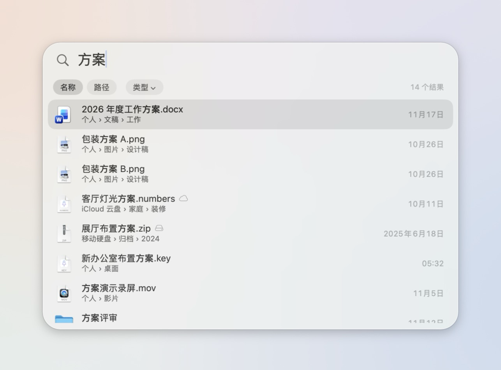
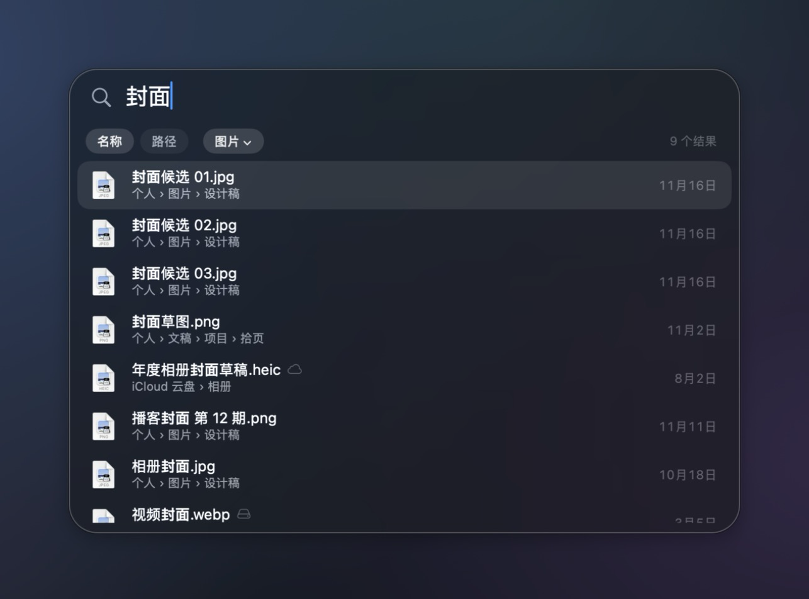
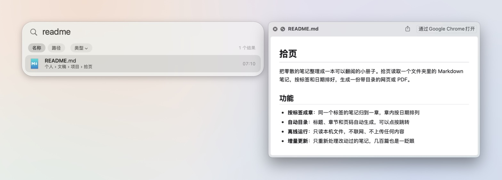
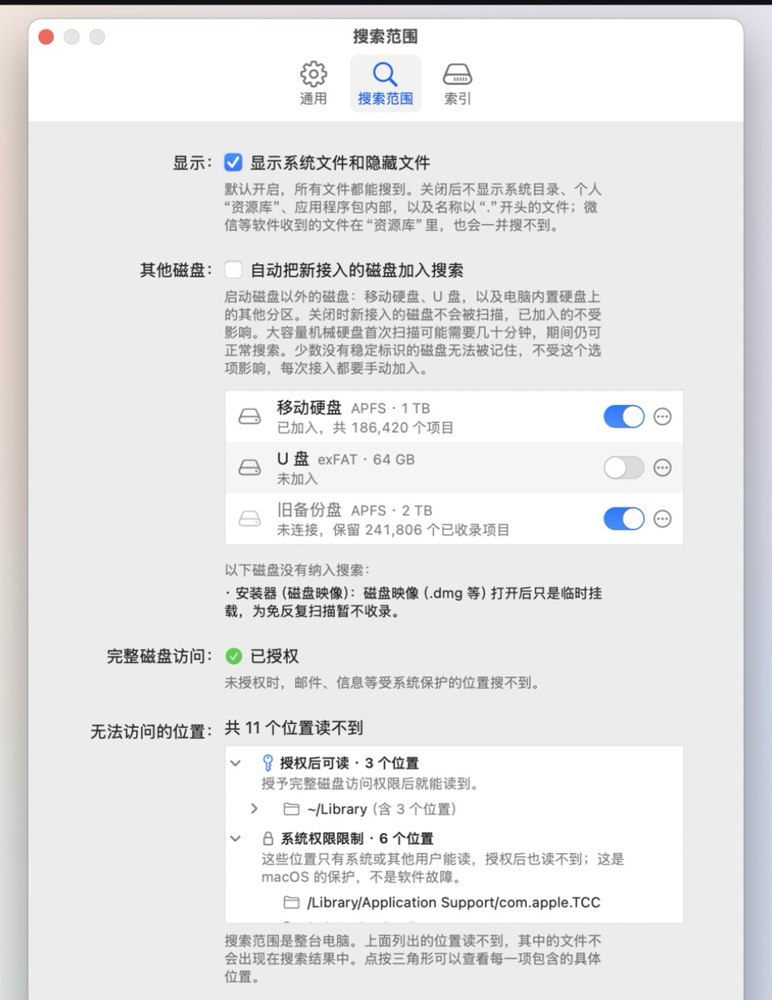

<p align="center">
  
</p>

<h1 align="center">索隐</h1>

<p align="center">Mac 上的文件名搜索。按一下快捷键，打一个字，两百多万个文件里的结果就出来了。</p>

<p align="center">
  <a href="https://github.com/nongtanpeidanjiu/suoyin/releases/latest">下载最新版</a>
  ·
  <a href="docs/安装说明.md">安装说明</a>
  ·
  <a href="PRIVACY.md">隐私说明</a>
  ·
  <a href="#从源码编译">从源码编译</a>
</p>



<p align="center"><sub>搜“方案”两个字。结果里有本机的文件，有 iCloud 云盘里还没下载的（带云朵），也有移动硬盘上的（带磁盘标记）。</sub></p>

名字取自《周易·系辞上》的“探赜索隐，钩深致远”，读音又正好是“索引”。我想让它做的事就是这两个字：藏着的也要找出来。

## 为什么做这个

我经常只记得一个文件名字里的半个词，想要的是：按一下快捷键，敲几个字，马上看到它在哪。而且不管它藏在哪里都要能搜到，包括以点开头的配置文件、个人“资源库”深处、应用程序包内部。聊天软件收到的文件就存在资源库很深的地方，名字明明记得，在访达里一层层点进去很费劲。

所以我写了索隐。它只做一件事：按文件名和路径找文件。索引是它自己建的，直接读文件系统、监听文件变化，不读也不依赖系统聚焦搜索的索引。隐藏文件和系统目录默认全部能搜。系统确实不让读的地方，它会一条条列出来告诉你，不悄悄跳过。

## 实际有多快

下面的数字都来自开发中的验收测试，测试机是一台 Apple M2、8 GB 内存的 Mac，系统 macOS 15.7.9。每个数字的测法和出处写在文末的[实测条件](#实测条件)里。测的是搜索核心本身（以命令行进程运行），界面另算。

在收录了 2,183,275 个文件和文件夹的整盘索引上，按名称搜索，95% 的请求在 9.8 毫秒内返回；按完整路径搜索在 13.7 毫秒内。<sup>[1]</sup> 输入框里每敲一个字，结果就跟着刷新一次。

文件新建、改名、删除之后，大约一秒就会反映到结果里，三种操作的 P95 都在 1.05 秒以内，隐藏文件夹里的变化也一样。<sup>[2]</sup>

它常驻在菜单栏。没有文件变化的时候，平均单核占用是 0.0073%；电脑上有日常的后台文件活动时，三分钟平均在 0.043% 到 0.888% 之间。<sup>[3]</sup> 两百万级别的索引整个放在内存里，进程物理内存占用实测 135 到 155 MB；后台把增量合并进索引的那一两秒会短暂升到 260 MB 左右，然后回落。<sup>[4]</sup>

第一次建索引，测试机上约 193 万个条目用了 17.87 秒，期间已经收录的部分就能搜。以后再启动，已有索引约 0.1 秒就能用。<sup>[5]</sup>

## 能做什么

默认按 <kbd>⌥ Option</kbd> + <kbd>⇧ Shift</kbd> + <kbd>空格</kbd> 在任何地方呼出搜索面板，再按一次收起。快捷键可以改，录入的时候就会检查是否和系统快捷键、面板里的按键冲突。

输入几个词，用空格隔开，每个词都要出现在文件名里，顺序随意。按 <kbd>Tab</kbd> 切到“路径”模式，词可以落在任意一级文件夹上：“质量 2026”能找到“质量”文件夹里名字带“2026”的文件，带“/”的一段路径也可以直接输入。还可以按类型筛选，文件夹、文稿、图片、音频、视频、压缩包、应用程序，用 <kbd>⌘1</kbd> 到 <kbd>⌘8</kbd> 切换。



<p align="center"><sub>深色模式下搜“封面”，再按 ⌘4 只看图片。</sub></p>

结果行用的是真实的文件图标，位置写成“个人 › 文稿 › 项目”这样，和访达里的叫法一致。名字再长也只占一行，从中间省略，扩展名总看得见。

| 按键 | 作用 |
|---|---|
| <kbd>回车</kbd> 或双击 | 打开文件 |
| <kbd>⌘</kbd> + <kbd>回车</kbd> | 在访达中显示 |
| <kbd>⌥</kbd> + <kbd>空格</kbd> 或 <kbd>⌘Y</kbd> | 快速查看预览 |
| <kbd>⌘C</kbd> | 复制完整路径 |
| <kbd>Tab</kbd> | 在名称和路径之间切换 |
| <kbd>⌘1</kbd> 至 <kbd>⌘8</kbd> | 切换文件类型 |
| <kbd>Esc</kbd> | 清空输入，再按一次收起 |

结果行也可以直接拖进别的应用。

预览窗口停在面板右边，上下键换一行，预览跟着换。Markdown、YAML、各种配置文件、字幕这类系统只给一个图标的文字文件，我让它直接显示内容，Markdown 会排好标题、列表和表格；国标编码的中文文本也能正常显示。



<p align="center"><sub>搜“readme”，按 ⌥ 空格。右边是排好版的 Markdown，不用打开文件。</sub></p>

iCloud 云盘和其他云盘里没下载到本机的文件，也能按名字搜到，搜索不会触发下载。<sup>[6]</sup> 移动硬盘、U 盘、内置硬盘的其他分区可以选择加入搜索。拔下后它的结果随即撤下，已收录的数据留在本机；扫到一半退出，下次打开接着扫。一块 USB 机械硬盘实测每秒收录约一千个条目，扫描时照常可以搜已收录的部分。<sup>[7]</sup>

读不到的位置都列在“设置 › 搜索范围”里，按“授权后可读”“系统权限限制”“原因不明”分组，系统目录也照列。我在没有完整磁盘访问权限的情况下测过一次，列出来的是 341 个位置。<sup>[8]</sup> 除了索隐自己的索引数据，它不主动排除任何位置。嫌系统文件太多，可以在同一页关掉“显示系统文件和隐藏文件”。



<p align="center"><sub>“设置 › 搜索范围”：上面是其他磁盘的开关，下面是读不到的位置清单。</sub></p>

第一次打开会有一个五步的设置向导，讲清楚要什么权限、外接磁盘要不要自动加入、快捷键用哪个，每一步都能跳过。界面跟随系统的浅色和深色模式。

## 还做不到的事

- 没有经过苹果公证。我没有付费注册苹果开发者账号，所以第一次打开会被系统拦下，需要去“隐私与安全性”里手动放行一次，步骤见[安装说明](docs/安装说明.md)。
- 只搜文件名和路径，不搜文件内容。
- 全角和半角的英文字母、数字目前不算同一个字，搜“ABC”找不到名字里写成全角“ＡＢＣ”的文件。英文大小写不区分。
- 索引文件没有加密。它存在你的个人文件夹里，记着全盘的文件名，以你的身份运行的其他软件能读到它，详见[隐私说明](PRIVACY.md)。
- 界面只有简体中文。
- 磁盘映像（.dmg 等）和网络磁盘目前不收录，设置里会写明哪些磁盘没纳入。
- 只支持 Apple 芯片的 Mac。所有实测都在 macOS 15.7.9 上做，更新的系统版本还没逐项验证。

## 安装

需要 Apple 芯片的 Mac，macOS 15.7.9 或更高版本。

1. 从[发布页](https://github.com/nongtanpeidanjiu/suoyin/releases/latest)下载 .dmg 安装包，打开后把“索隐”拖进“应用程序”。
2. 第一次打开被系统拦下时，去“系统设置 › 隐私与安全性”，点“仍要打开”。
3. 按设置向导授予“完整磁盘访问权限”，也可以先跳过。

每一步具体点哪里、怎么核对下载的文件没被改过、怎么彻底卸载，都写在[安装说明](docs/安装说明.md)里。

## 完整磁盘访问权限

macOS 把邮件、信息、Safari 数据、其他应用的数据文件夹这些位置保护了起来，不授权的话，里面的文件名读不到。授权以后，索隐用这个权限读取文件和文件夹的名称、大小和修改时间来建索引；只有你主动预览某个文件时，才读那一个文件的内容。它不修改、不移动、不删除任何文件。

判断有没有授权，我的办法是尝试打开一个只有授权后才打得开的系统文件，打开后马上关掉，不读里面的内容。<sup>[9]</sup>

不授权也能用，只是搜索范围小一些。为了不在你看到说明之前就弹出系统的“想要访问……”提示，未授权时索隐不去碰其他应用的数据文件夹，等你授权后再补上。

## 隐私

索引只记文件名、大小和修改时间，放在个人“资源库”的应用支持文件夹里。预览部分文字文件时生成的临时副本放在缓存文件夹，只有你的账户能读，预览关掉就删。索隐不收集使用数据，不上传任何东西，联网只为检查更新。细节在[隐私说明](PRIVACY.md)里。

## 自动更新

正式版用开源组件 Sparkle 做自动更新。默认每天检查一次本项目 GitHub 发布页上的更新清单，请求里不带用户或机器标识，也不发送系统信息。更新包用我的私钥签名，应用里内置了对应的公钥，签名对不上就不装。

在“设置 › 通用 › 更新”里可以关掉自动检查，也可以选更新方式：自动下载并安装、自动下载后安装前问你（默认），或者只提醒有新版。

## 常见问题

**和聚焦搜索冲突吗？**
不冲突，可以同时用。索隐不读也不依赖聚焦搜索的索引，那边开着关着都不影响它。

**索引占多少磁盘？**
测试机上约 195 万个条目时，索引文件约 106 MB。<sup>[10]</sup> “设置 › 索引”页里能看到当前的实际大小。

**某个文件搜不到怎么办？**
先看“设置 › 搜索范围”里“显示系统文件和隐藏文件”有没有被关掉，再看这个文件是不是在“无法访问的位置”列表里，或者在一块还没加入搜索的磁盘上。

**为什么首次打开会被系统拦住？**
因为没有经过苹果公证，所有没公证的软件系统都会拦一次。原因和放行步骤见[安装说明](docs/安装说明.md#为什么会被拦)。

**能商用吗？**
不能，见下面的许可。

## 从源码编译

不需要 Xcode，装好 Command Line Tools（`xcode-select --install`）就行。我开发和测试用的是 Swift 6.1.2。

```sh
git clone https://github.com/nongtanpeidanjiu/suoyin.git
cd suoyin

# 搜索核心和命令行工具
swift build -c release

# 自动化测试
swift test -c release --disable-xctest --enable-swift-testing

# 打包成应用（预览版，显示名“索隐（预览）”，输出 App/.build/FileSearchDemo.app）
App/Tools/bundle.sh

# 用演示数据运行界面，不读你的磁盘
cd App && swift run SearchApp --demo
```

界面工程第一次编译时会从 GitHub 下载 Sparkle 的预编译框架，需要联网。系统是按签名认“完整磁盘访问权限”的，打包脚本找不到固定的签名证书时会用临时签名，那样每次重新打包都可能要重新授权。`bundle.sh --release` 是我发布正式版用的，需要我本机的签名证书和更新密钥，别人运行会直接报错退出。

代码结构和参与方式见 [CONTRIBUTING.md](CONTRIBUTING.md)。

## 许可

索隐以 [PolyForm Noncommercial License 1.0.0](LICENSE) 发布。你可以看源码、改源码、自己用，也可以出于非商业目的分享原版或改过的版本，分享时附上许可证和版权声明。不允许任何商业用途。

这不是开源许可证。源码公开、可以修改，但用途受限制，不符合开源的定义。想商用的话请先联系我另行授权。

## 致谢

自动更新用的是 [Sparkle](https://sparkle-project.org/)（MIT 许可），许可证文本来自 [PolyForm Project](https://polyformproject.org/)。其他部分只用 macOS 自带的系统框架，界面里的小图标是苹果的系统符号。完整清单见 [THIRD-PARTY.md](THIRD-PARTY.md)。

---

## 实测条件

除特别注明外，都在同一台 Apple M2、8 GB 内存、macOS 15.7.9 的 Mac 上测得，对象是搜索核心（以命令行进程运行，界面另计），索引覆盖该机启动磁盘上当时可读的全部范围。P95 指 95% 的请求不超过这个时间。MB 按 1,000,000 字节计。

1. 搜索延迟：收录 2,183,275 个条目，开启“显示全部”，每次取首屏 50 条并算出总数；名称、路径各 200 次请求，覆盖高命中、稀有、零命中、跨目录和多关键词，轮换四种排序。名称 P95 9.825 毫秒，路径 P95 13.685 毫秒。出处：[里程碑 4 门面验收](docs/里程碑4-门面验收.md)“自动化与实机”。按类型筛选时八种类型各 100 次请求，P95 在 6.565 至 14.494 毫秒之间，见同文档“任务单 15 · 最终自动化与真机数据”。
2. 变化到可搜：在测试文件夹里用真实的文件系统事件，创建、改名、删除各测 12 次，约每 25 毫秒查一次，P95 分别为 1,049.99、1,051.17、1,043.07 毫秒。出处：[里程碑 2 占用专项验收](docs/里程碑2-占用专项验收.md)“任务单 24 · 文件变化到可搜”。隐藏文件夹内的新建、改名、删除 P95 为 1.025、1.029、1.021 秒，出处：[里程碑 4 门面验收](docs/里程碑4-门面验收.md)“任务单 26 · 新建、改名和删除的命中延迟”。
3. 处理器：无文件变化的 180 秒窗口平均单核 0.0073%，出处：[里程碑 2 占用专项验收](docs/里程碑2-占用专项验收.md)“任务单 24 · 180 秒真实全盘监听”的安静对照。带真实后台文件活动的三分钟全盘监听，各轮平均单核 0.043% 至 0.888%，出处：[里程碑 4 门面验收](docs/里程碑4-门面验收.md)“三分钟监听”及任务单 13、任务单 15 的监听表。大量文件集中变化时会更高：一个三分钟内收到 8,956 个文件事件并触发一次索引合并的窗口，平均单核 2.180%，见[里程碑 2 占用专项验收](docs/里程碑2-占用专项验收.md)“任务单 24 · 合并峰值专项”。
4. 内存：上述三分钟监听中，进程最高物理内存占用 134.678 至 154.601 MB，出处同第 3 条的里程碑 4 各表。后台合并时一次实测峰值 258.92 MB，约 1.4 秒后回落到 124.45 MB，见[里程碑 2 占用专项验收](docs/里程碑2-占用专项验收.md)“任务单 24 · 合并峰值专项”。
5. 建索引与启动：从空的数据目录开始，进程启动到 1,934,105 个条目可搜用时 17.87 秒，出处：[里程碑 4 门面验收](docs/里程碑4-门面验收.md)“任务单 13 · 手动重建”。已有索引时，七次新进程启动到返回首屏结果用时 103.598 至 120.053 毫秒，系统缓存为热状态，出处：[里程碑 2 占用专项验收](docs/里程碑2-占用专项验收.md)“查询、启动和兼容”。
6. 云盘占位文件：抽查 7 个未下载的文件，搜索前后“未下载”标记、占用块数和大小都没变，出处：[里程碑 3 云盘与外接盘验收](docs/里程碑3-云盘与外接盘验收.md)“云盘”。
7. 外接硬盘：同一块 USB exFAT 机械硬盘，首次扫描到约 243.8 秒时已收录 255,729 个条目，约每秒 1,049 个，出处：[里程碑 3 云盘与外接盘验收](docs/里程碑3-云盘与外接盘验收.md)“任务单 16 · 真盘速度、查询和写入”。速度随盘的目录结构和位置变化。
8. 读不到的位置：在没有完整磁盘访问权限的进程中从整个启动磁盘建索引，记录到 341 个原始位置，归并为 22 条，出处：[里程碑 4 门面验收](docs/里程碑4-门面验收.md)“任务单 14 · 全盘访问状态”。
9. 授权检测方式：见[里程碑 4 门面验收](docs/里程碑4-门面验收.md)“任务单 13 · 完整磁盘访问与报告范围”。
10. 索引大小：约 195 万行的本机索引，持久文件合计 106,369,799 字节，出处：[里程碑 4 门面验收](docs/里程碑4-门面验收.md)“任务单 15 · 同档体积与物理占用”，行数见同节“类型筛选”。

---

## In English

Suoyin (索隐) is a menu-bar file name search tool for macOS on Apple silicon. It keeps its own index of every file name on the Mac, hidden files and system folders included, and does not use the Spotlight index. On my test Mac with about 2.18 million entries, 95% of name searches returned within 10 ms, and new, renamed or deleted files showed up in about a second. The interface is Simplified Chinese only, and the source is published under the PolyForm Noncommercial License 1.0.0, which is not an open-source license and does not allow commercial use.
