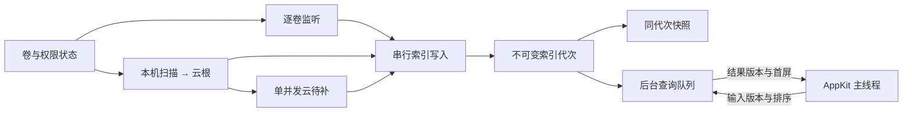

# 技术设计 · Mac 文件名搜索

版本 v1.1，设计基线 2026-11-18。v1.0 已由统筹方批准。v1.1 落实路径分词和云请求限时裁定。供统筹方安排五个里程碑的开发与验收。产品面向个人 Mac，支持 macOS 15.7.9 及以上和 Apple Silicon。应用按统筹方提供的中文 AppKit 设计稿实现。

## 1. 目标与预研基线

| 指标 | 产品或核心验收目标 | 本机预研读数 |
|---|---|---|
| 本机首次建库 | 可读非云盘范围 ≤30 秒，建库期间已发布的范围可搜 | 四线程批量读取 2,082,759 条，13.898 秒到索引就绪并数到 50 项名称命中 |
| 后端首屏 | 名称、路径子串和四列全局排序 P95 各 ≤20 毫秒 | 2,127,824 条，六类中最高 16.106 毫秒，来自完整绝对路径精确匹配 |
| 内存 | 核心常驻 RSS ≤200 MB，应用常驻 RSS ≤300 MB | C++ 合并索引约 166 MB |
| 启动 | 有有效索引时到可搜 ≤3 秒 | 新进程热缓存 53.31–54.38 毫秒，装载中位 50.70 毫秒 |
| 快照保存 | 保存、替换和恢复正确，记录整库存盘时间 | 单次 32.10 毫秒，115,581,557 字节 |
| 界面与空闲 | 输入到正确首屏 P95 ≤50 毫秒，平稳五分钟平均单核 CPU <1% | 无 AppKit 首屏数据。空闲 0.0114%，测量仅含索引驻留与 FSEvents 回调接收 |

本轮沿用预研范围和原始语料。预研数据取自 macOS 15.7.9、M2、8 GB，真实条目仅覆盖当时进程可读范围。路径子串、Unicode 规范化、排序、Swift 内存布局、快照校验及实际事件应用均为正式开发的验证对象。禁止运行 searchfs 或历史事故探针。[预研报告](../.flow/tasks/20261118-Mac文件名搜索技术预研/drafts/最终预研报告.md) · [输入核对](../.flow/tasks/20261118-Mac文件名搜索技术设计/evidence/预研输入核对.md)

## 2. 命令行工程

单个 SwiftPM 工程。核心库供命令行基准和 AppKit 应用共同调用。SwiftPM 清单声明 `platforms: [.macOS("15.7.9")]`，构建脚本使用现有 Command Line Tools 输出 arm64 Release 产物，并核对实际二进制架构和最低系统声明。打包脚本在暂存目录组装 `Contents/MacOS`、`Contents/Resources` 及 `Info.plist`，写固定 Bundle ID、执行文件名、版本、`LSMinimumSystemVersion`，并用 `LSUIElement` 配套菜单栏形态。构建产物发布前验证 bundle layout 和签名。脚本不依赖 `xcodebuild` 或 Xcode 自带工具。[SwiftPM 命令行指南](https://www.swift.org/getting-started/cli-swiftpm/) · [最小系统版本](https://developer.apple.com/documentation/bundleresources/information-property-list/lsminimumsystemversion) · [代理应用声明](https://developer.apple.com/documentation/bundleresources/information-property-list/lsuielement)

本机 CLT 为 Swift 6.1.2、SDK 15.5。零依赖 SwiftPM 包显式指定 15.7.9 后，`swift test --disable-xctest --enable-swift-testing` 实际运行并通过 1 个测试。XCTest 单独启用时编译失败，缺少 XCTest 模块。工程以 Swift Testing 作为默认测试入口。若以后 CLT 版本出现测试框架兼容问题，使用独立 SwiftPM 可执行测试目标运行同一组输入、参考结果和失败退出码。该备用入口已验证能够构建和运行。安装软件或改动工具链须另有授权。[最小探针日志与结论](../.flow/tasks/20261118-Mac文件名搜索技术设计/evidence/命令行测试结论.md) · [Swift 6 测试机制](https://www.swift.org/blog/announcing-swift-6/)

## 3. 模块、接口和并发模型

接口名称用于约束职责。卷和路径均携带来源作用域，所有消息携带卷挂载代次，取消指令同时作用于该代次的扫描、修补和查询任务。

| 模块 | 主要接口和责任 |
|---|---|
| 卷和范围 | `mounts → VolumeDescriptor[]`，`pathInVolume → logicalPath`。提供挂载点、卷身份、日志 UUID、访问能力、路径映射与范围分类。发布挂载、卸载、重连和权限变化。 |
| 扫描器 | `scan(volume, root, generation) → Batch / CoverageDelta`。返回目录项及明确的覆盖状态。使用 getattrlistbulk 和普通接口回退，把待补云目录交给云队列。 |
| 变更跟踪 | `watch(volume, since) → EventBatch`，`requestRecheck(scope)`。按卷接收、合并及转发事件，识别历史无效和需重扫分支。 |
| 云目录服务 | `enqueue(volume, directory)`，`cancel(scope)`。独立单并发列取一级元数据，返回子项、重试计划或待补状态。 |
| 索引写入与视图 | `apply(batch, frontier)`，`view() → IndexView`。串行处理新增、修改、移除、范围可见性和排序更新，原子发布不可变代次。 |
| 查询 | `search(view, query, mode, order, cursor, limit, inputVersion) → ResultPage`。返回索引代次、首屏条目和分页游标。首屏只物化所需名称、所在目录、大小、修改时间和动作定位标识。 |
| 快照 | `load → candidate`，`persist(view, checkpoints)`。验证同一代次中记录与各卷事件编号。执行延时合并、原子替换和恢复交接。 |
| AppKit 和系统集成 | 输入与查询调度、NSTableView 数据源、菜单栏、全局热键、文件动作、权限引导、覆盖提示和登录项状态。 |

AppKit 主线程只接收输入、处理系统交互和更新列表。索引单写入通道维护批次、卷状态和已应用事件位置。底层目录 I/O、云盘和快照各有后台通道，后台任务间共享只读代次。查询高于扫描和快照队列优先级，分块检查取消。输入、过滤范围或排序改变时生成新输入版本。结果到达主线程前复核输入版本和范围代次，丢弃旧请求。常规文件变化允许已在计算的只读代次完成，并刷新当前页。卸载或权限收缩须先提升范围代次并撤下相应行。保留同代次的分页游标，代次切换后重查首屏，避免重复或漏页。

## 4. 首建、卷身份和覆盖范围

### 4.1 路径、卷与索引批次

- 本机卷以逻辑根为主，从 Data 物理根补扫描未由 firmlink 映射的分支。将 firmlink 映射和卷根记录成映射表，遇其他挂载点交由该卷自己的枚举。用同一个父目录与原名标识目录项。符号链接只登记自身，硬链接的不同名称分别保留。每个目录在进入前用不跟随链接的元数据访问确认类型、当前卷及 SF_DATALESS。
- 外接可读本地文件系统自动发现。持久标识采用可用文件系统卷 UUID，历史复用还需 FSEvents 日志 UUID、根映射和卷属性检查通过。运行时以挂载代次、临时设备号和挂载点定位。设备号或卷名相同均不能作为复用依据。卷标识缺失或疑似克隆冲突时视为新实例，重新枚举，旧快照结果保留隐藏。拔出立即隐藏、取消该卷工作，重连按当前根核对与补扫。相同名字的两块盘有独立视图和事件编号。[卷 UUID](https://developer.apple.com/documentation/foundation/urlresourcevalues/volumeuuidstring) · [逐卷事件和日志身份](https://developer.apple.com/library/archive/documentation/Darwin/Conceptual/FSEvents_ProgGuide/UsingtheFSEventsFramework/UsingtheFSEventsFramework.html)
- 每卷先建立监听并登记采集边界，再派发扫描。默认本机 4 个目录工作线程，getattrlistbulk 批量取名称、类型、大小、修改时间和标记。依据返回掩码解析。元数据缺失时用 lstat 补，明确不支持批量读取时回退为 readdir + lstat。权限拒绝单独登记，不作空目录处理。批量遇正常竞争造成条目消失时，标记父目录待核对。
- 按文件系统分段，先本机后云根。目录级工作完成后成批写入，可搜批次立即发布，覆盖状态区分已加载、本机扫描中、正在更新、受限、离线和仍待补齐。目录类型和范围过滤在写入前计算，并保留默认收起的元数据供切换显示。
- 卷挂载代次之外，串行写入器给每次目录枚举或复查分配递增工作序号。发现目录变脏时提高该目录的最低可接受序号。目录搬移、删除或递归复查也提高相应子树的最低可接受序号。批次提交时同时核对挂载代次、目录序号与祖先子树限制。旧批次即使稍后返回也不得覆盖已应用的新观察。已作废批次不贡献覆盖或已处理位置。缺少满足新序号的成功观察时保留待复查，扫描期间记录的变化在标记最终覆盖前完成核对。
- 快照、临时快照及内部日志放在当前用户的专用数据根，排除该子树的结果和监听处理。若事件作为上级目录变更送达，仍复查上级的其他子项，复查时排除自身子树。不得仅凭写入来源标记全局丢弃同批其他应用事件。

### 4.2 云盘

已知用户云根为实际识别的 `~/Library/CloudStorage/OneDrive*` 提供商目录和 `~/Library/Mobile Documents/com~apple~CloudDocs`。发现依据和当前根存在性需在各支持系统检验。用户范围的所有可列举占位文件按名称可搜。前台发现带 SF_DATALESS 的目录时保留该目录的结果和待补标识，跳过其内部。云根待补与本机扫描使用不同队列。

后台单并发、逐目录处理。初始按 30 秒请求预算设计，并以实机可用性验证。成功列举一级子项后发布，发现更深未加载目录时另排队。失败、超时或取消保留“仍待补齐”，计划指数退避并在重新联网或用户重试时触发。取消、卸载和请求代次失效时，立即作废结果。底层调用返回后才释放并发槽。统筹方已接受逻辑时限与结果撤销，采用同进程方案。只取目录及条目元数据，通用类型图标由应用或系统类型图标缓存生成。用户主动打开文件时才交给系统处理文件。路径比较以真实云根作用域为准，提供商回收站根及后代从补齐和结果中硬排除。[Apple TN3150](https://developer.apple.com/documentation/technotes/tn3150-getting-ready-for-data-less-files)

### 4.3 默认收起规则与优先级

| 优先级 | 规则 | 默认视图与显示全部 |
|---|---|---|
| 1 | 作用域外、设备或虚拟挂载、未挂载卷、不可列举或当前权限待验范围、应用自己的索引与日志子树、提供商识别的回收站子树（如 OneDrive 根的 `.Trash`） | 不发布结果。回收站不排队。普通时间超时的可见云目录名称带待补状态。 |
| 2 | OneDrive 识别根、iCloud 用户文档根及其用户内容 | 不受父目录是 Library 或根路径标为系统的影响。其内部实际缓存、隐藏项目和包内部按后续细则处理。 |
| 3 | 逻辑路径组件前缀 `/System`、`/bin`、`/sbin`、`/usr`（除 `/usr/local`）、`/private/etc`、`/private/var`、`/private/tmp`、`/Library/Apple`、`/Library/Updates`、`/Library/Developer/CommandLineTools` | 默认收起系统内容。路径前缀按完整分量比较，Data 物理路径先映射后分类。 |
| 4 | `~/Library/Caches`、`/Library/Caches`、`/System/Library/Caches`、系统临时目录、应用容器已知的 `Data/Library/Caches` | 默认收起。普通用户目录内名为 Caches 的文件夹按正常用户内容处理。 |
| 5 | 点开头且非 `.`、`..` 的路径分量，`UF_HIDDEN`，或可通过元数据取得的 Finder 隐藏属性 | 默认收起该条目和隐藏目录后代。云提供商自身维护目录保持收起或按明确的永久规则处理。 |
| 6 | Finder 语义上的包目录。先识别 .app、.appex、.bundle、.framework、.plugin、.kext、.xpc 等已知类型，对其他候选目录用元数据标识或 `isPackage` 补判 | 包本身及所属目录正常套用其他规则。包内部默认收起。避免对每个文件做包属性查询。 |
| 7 | 其余可读条目 | 正常显示。 |

一个“显示全部”开关解除默认收起标记，仍遵循首行边界。已存在的结果按索引位图重筛，不触发磁盘扫描。遇重命名或搬移时重新计算受影响子树的分类。目录名称、当前卷、权限和待补状态在界面上保持可解释。[包属性](https://developer.apple.com/documentation/foundation/urlresourcevalues/ispackage) · [平台核对](../.flow/tasks/20261118-Mac文件名搜索技术设计/evidence/平台机制核对.md)

## 5. 内存布局、匹配和排序

### 5.1 核心结构与内存预算

以每卷或分段的定长记录和连续原始名称字节池为索引。建议基础记录为 24 字节，含 32 位名称偏移、32 位父目录编号、64 位逻辑大小、64 位秒级修改时间。用独立紧凑标记表示类型、有效性、默认收起和待补状态。可取得的亚秒修改时间进入 UInt32 附列，以秒和纳秒定序。边缘情况用缺省值与有效性位区分。路径按父链组装，只有可视行或动作目标转成 String 或 URL。卷根锚点不计入结果。序列化区块显式编码整数和字节长度，分段的偏移先校验容量。

按 2,127,824 条估算，24 字节记录约 51.1 MB，若每条另用 2 字节标记约 4.3 MB，沿用预研原名池约 47.5 MB。四种排序各用一组 UInt32 行号，合计约 34.0 MB。纳秒附列约 8.5 MB。上述约 145.4 MB，为数组和名称池下界。其余约 54 MB 的核心预算覆盖规范化例外池、分段索引、目录查找、查询临时区、变动覆盖层和运行时开销。实际 RSS 将包括分配器和页驻留影响。查询与快照共用只读区块，写入按受影响块更新，异步保存流式写入，避免并存多个完整拷贝。多并发查询和后台重整的峰值另记录。

ASCII 快路径在匹配时折叠 A–Z，NFC 后发生变化的非 ASCII 字节单独缓存，并用分段位图与偏移定位。必要时加有内存上限的临时加速缓存，超限可淘汰并用精确算法重算。推进压缩、修剪增量和缓存后要同时复测 P95，不能用跳过候选换取达标。

### 5.2 名称及路径匹配

- 显示和打开使用原始名称及原始路径分量。比较键用 Unicode NFC，对英文 ASCII 大小写等价。文件系统身份用原始分量，规范化等价的两行仍由各自的文件系统标识区分。解码异常要保留原始字节用于路径动作，并按一致的展示与检索规则处理。[Unicode NFC](https://unicode.org/reports/tr15/)
- 名称模式按空格分词，忽略连续分隔产生的空词。每个词都须是同一条目名称的子串。以较长或稀有词作候选，再精确复核其余词。空查询按当前排序和范围展示第一页。
- 路径模式与名称模式一样按空格分词。每个词都是规范化完整逻辑路径中的连续子串，全部命中才返回。路径含条目名。`质量文件夹/路径` 是一个跨目录分量的词。`质量 2026` 的两个词可以分别落在目录和文件名中。

### 5.3 路径子串的实现与性能

先测精确直接实现。若未达到预算，可为每个路径词独立生成 KMP 前缀表，并合取各词命中。对每个需要的目录缓存处理完其完整父路径与末尾斜线后的状态，包含“祖先已有完整匹配”标记。从已知父状态向子目录输入目录名和斜线即可得子状态。最终拿父状态继续扫描文件名或目录名，兼顾祖先命中、跨分量连续命中和文件名内命中。缓存以当前查询与索引代次为键，目录移动或变更不会沿用旧代状态。每条只访问必要名称字节，不物化每个候选的完整字符串。

常见高命中查询直接按所选列的有序行号测试，够一页即停。选择性高的查询可先用至少一个必需字节片段的分段过滤或多核扫描，再逐项用同一精确规则核对。加速条件只用于跳过可以确定不含该片段的范围，并对祖先已匹配的后代引入例外。短词、跨斜线、任一祖先路径单独命中等情况下走状态机，确保跳过判断不造成漏检。稀有、零命中、深路径及数据量较大时，可在不同只读分片并行匹配，按全局排序合并分片首屏。每个分片持有局部前 K，取并集后选全局前 K，可保持精确顺序。页码需要同一定序和游标。首次实现先测 1 与有界多核，在 8 GB M2 上把扫描进度、查询竞争和内存一并实测。只有精确结果通过且路径子串 P95 ≤20 毫秒的调度方案可通过里程碑 1。

### 5.4 四列全局排序

名称、所在路径、大小、修改时间均可升降序，默认名称升序。所在路径列使用父目录的完整逻辑路径，路径模式使用包括条目名的完整路径。名称主键用 NFC 和 ASCII 大小写折叠后的字节序。路径主键按规范化父路径排序，复用目录级排名，计算排名时使用真实连接后的路径比较规则。相同主键依次按规范化名称、原名、卷身份和稳定行标识定序。大小按文件的逻辑字节数比较，目录不递归计算大小。修改时间按其秒与可取得的纳秒比较。缺失值单独置尾。正向与反向排序沿对应段迭代，规则对一代索引内结果保持稳定。

直接实现未达标时可在分片保留紧凑有序行号。扫描期间每批排序，查询按小型多路合并器合出全局顺序。修改时在增量有序段写入新键并使旧行失效，后台适时压并。路径移动对受影响目录排名重算，批量发布同一代次，避免新路径搭配旧排序键。显示全部和权限过滤在产出行前判定，不能先取固定个数的任意命中再排序。分页上限限制物化行数，不能改变全局前 50。匹配总数可异步计算，首屏不等待完整计数。

高命中量使用有序遍历提前停止。命中极少或多分片时可反向使用候选位图或有界堆，仍检查所有能进入前 K 的项。内存不足时允许分段或减少辅助缓存，四列首屏仍须同时满足正确性和时延。发布尚未构建某列顺序的批次时，对该批用精确有界合并补足，不能把暂未排序的行当成看不见。

## 6. 快照、更新与恢复

### 6.1 快照格式

第一版使用紧凑快照作为索引的唯一持久层。单文件头含 magic、格式版本、规范化与排序规则版本、快照代次、构建标记、段表和校验描述。每卷段含持久卷身份、日志 UUID、访问范围与完整度、根映射、目录和名称字节池、定长记录、待补元数据及该卷已应用的事件位置。排序辅助表若保存，其格式、排序规则和记录代次必须同卷对应。整数用小端编码，段位置、长度及条数均校验上限。流式 SHA-256 覆盖头、事件位置和文件体，校验字段自身按零值计算。加载前验证范围、偏移、条目个数、父链、索引有效性、卷身份以及规则版本。文件缺失、截断、整体验证失败或未知格式时重新建库。派生排序表可有条件重建，但需要维持启动时间预算。快照为本机用户私有数据，存于专用用户目录，只保存索引元数据。

### 6.2 提交规则

**一份快照里的每个卷段数据和它的已应用位置来自同一索引代次。** 监听接收位置、待复查位置、已应用位置和已落盘位置分别维护。事件 ID 可以跳号，按该卷实际交付的顺序和必要的复查屏障推进。事件合并时保留所覆盖的各项工作及批次位置，只有它们全部处理或按覆盖规则明确落入同代次的权限受限、排除、待补状态后才能确认处理。重复事件使用当前目录内容做幂等差分。应用自身目录事件按政策确认排除，不影响同批其他目录的处理。

保存时由索引写入器一次取得不可变索引代次与其事件位置。保存者用同目录独占临时文件顺序写入、计算校验、检查字节数和错误、flush、fsync、关闭，再原子 rename 替换正式文件。可用时同步目录并检查结果。替换前失败继续使用旧快照。替换后若目录同步失败，记录持久性未确认，重新启动时按正式路径上实际存在的有效代次处理。仅在正式切换成功后记录新文件代次，目录同步结果另记。单一保存通道避免较旧代次覆盖较新代次。崩溃后忽略残留临时文件，只加载完整有效的正式快照。正常变动按短静默期延时合并，有持续变化时设最大等待窗口并保留下一轮 dirty 标记。初始建议静默约 2 秒、最长 15 秒，按空闲指标调优。正常退出停止接收新工作后请求一次最终写入，超时时保留上一个可恢复版本。主线程不会等待云补齐。断电持久性需实机验证。[Apple rename 手册](https://developer.apple.com/library/archive/documentation/System/Conceptual/ManPages_iPhoneOS/man2/rename.2.html)

### 6.3 监听、追平和异常分支

逐卷注册 FSEventStreamCreateRelativeToDevice。将相对卷根的事件路径转换为逻辑路径。首次扫描或重建时先启监听，并缓冲扫描期间的事件。已完成根范围的复查任务以可追踪批次应用，再标记其覆盖就绪。初始没有可信事件位置时，从实际监听的有据边界开始，不能凭系统当前最大 ID 推进。若完成全盘扫描后仍没有可证明的处理位置，快照记需要核对标记，下次重扫该卷。

| 分支 | 行为与可推进范围 |
|---|---|
| 启动时身份、规则和日志连续性可用 | 使用校验通过且当前作用域允许的快照开启查询，标为正在更新。从该卷快照已应用 ID 开始重放。收到 HistoryDone 仅代表历史已交付。待历史事件要求的目录工作全完成后才标为追平并提交相应位置。 |
| 普通文件或目录事件、重命名 | 合并到父目录或脏子树。跨目录移动要核对两端，根不明确则提升复查范围。逐目录差分在满足 §4.1 的工作序号限制且替代该事件对应的旧观察后才可推进。复查期间新增的事件单独保留待复查，待满足对应序号后再推进。 |
| MustScanSubDirs，无丢失标记 | 从指明目录递归核对。完成复查才跨过这个屏障。 |
| UserDropped、KernelDropped、本队列溢出、事件 ID 回绕、日志 UUID 改变／消失、编号倒退或另有历史不连续证据 | 使该卷的旧游标无效，标为待重建。重新建立监听与卷级基线再复查，其他卷继续运行。针对日志裁剪导致历史不可证的情况，按整卷重扫处理。 |
| RootChanged、卷卸载或重连、映射发生变化 | 暂停该范围发布、验证当前卷及映射。身份和历史可用时重放并复查挂载根，否则整卷重扫。卸载时增加范围代次以立即隐藏旧结果。 |
| 权限收缩或无法确认先前授权范围 | 暂时从搜索范围撤下相关段。事件被归入受限状态后保留对应覆盖原因。权限恢复时重新枚举受影响范围再发布。普通可验证快照段可尽快查询。 |
| 快照损坏、无校验成功版本 | 根据可判定的损坏范围重扫，整文件校验失败时整体重建。重新建立事件基线。 |

例如代次 V 中卷 A 已应用到 100，事件 110 的重扫尚在进行，事件 120 的其他目录先完成。V 落盘时最多记录 100。若原子切换前进程退出，仍从旧快照的已应用位置重放。重连检测到日志不可用时，整卷结果进入重新核对，其他卷使用各自独立位置。无权限或云端未加载目录不可用空目录解释。监听事件、范围变更和写快照均通过同一提交模型。[Apple FSEvents](https://developer.apple.com/library/archive/documentation/Darwin/Conceptual/FSEvents_ProgGuide/UsingtheFSEventsFramework/UsingtheFSEventsFramework.html)

历史回放以可观察证据判定。正常事件 ID 本来就可能跳号，首条 ID 大于保存位置本身不能区分正常跳号与日志裁剪。对已知丢失、恢复旧磁盘状态或离线期间可能在其他系统写入的卷，通过目录核验或整卷重扫建立新基线。对长期未核对的卷调度有界复查，降低历史不可证时的漏项风险。HistoryDone 和较大的 ID 都不足以单独证明一致。
## 7. 界面结构、权限与登录启动

- 搜索窗口包含名称和路径模式切换、输入框、范围开关、四列 NSTableView 与覆盖状态。可视结果行复用，避免对全部命中建立 AppKit 对象。中文输入法的组合态保持原样，已提交文本才开始计算。切换列头排序时提交新的请求，保留选择的稳定身份并复核是否仍可见。主线程首次实际绘制对应结果版本时记录首屏时间。
- 菜单栏 NSStatusItem 提供打开窗口、覆盖状态、设置和退出。支持独立窗口、回车和双击打开、在 Finder 中定位。查询阶段使用通用类型图标。文件打开或定位前检查对应卷、挂载与条目状态，交给 NSWorkspace 执行用户动作。窗口关闭后按用户需求继续后台维护。
- 全局热键使用 SDK 提供的 Carbon HIToolbox `RegisterEventHotKey` 和指定热键事件。默认 Option + Shift + 空格，对应 `optionKey | shiftKey` 与 `kVK_Space`。只接收已注册组合，不使用辅助功能、键盘监控或全局事件 tap。注册失败提示冲突或系统拒绝。修改时新组合注册成功才保存并释放旧组合，相同组合沿用原注册。退出时注销。系统版本、键盘布局和其他进程冲突以实机为准。[Apple 工程师说明](https://developer.apple.com/forums/thread/763878) · [当前 SDK 核对](../.flow/tasks/20261118-Mac文件名搜索技术设计/evidence/平台机制核对.md)
- 首次启动解释完整磁盘访问用途和可读范围，可引导用户到系统设置，允许在现有权限下先搜索。启动、返回界面或收到权限错误时，复核实际目录访问能力。按范围记录已验证或受限。应用不读取 TCC 数据库、不代授权。对来源不明或先前授权的受保护快照段，访问核对前不发布。授权变化用当前目录差分或重扫补齐受影响段。覆盖状态区分系统拒绝、卷离线和云待补。[Apple 平台访问控制](https://support.apple.com/guide/security/controlling-app-access-to-files-secddd1d86a6/web)
- 登录自启动采用 `SMAppService.mainApp`。按用户开关注册或注销，根据 `status` 呈现已启用、待系统批准、关闭或错误，登录时常驻且只启动一个应用实例。更新前后在系统设置和实际登录行为两处验证。[Apple SMAppService](https://developer.apple.com/documentation/servicemanagement/smappservice)

## 8. 稳定签名

**最晚在里程碑 4 开始任何正式应用的完整磁盘访问授权或注册登录项前完成稳定签名。** 里程碑 1–3 的命令行与隔离测试可先推进。里程碑 5 以已签名的 M4 应用为旧版基线，以稳定身份升级并验证授权和登录启动。

实际执行前取得用户同意后，在登录钥匙串用证书助理建立专用自签代码签名证书，保留私钥并安全备份。先固定 Bundle ID、生产安装路径和签名标识。在构建脚本中依证书与标识生成稳定的 designated requirement（DR），用 `codesign` 给完整 .app 签名，固定当前身份并保存公有证书指纹。只给已批准的本机身份应用必要的信任设置。证书轮换需要影响评估，避免在已授权版本中途换身份。[Apple 签名操作](https://developer.apple.com/library/archive/documentation/Security/Conceptual/CodeSigningGuide/Procedures/Procedures.html) · [Apple TN3127](https://developer.apple.com/documentation/technotes/tn3127-inside-code-signing-requirements)

取两版产物，分别运行签名完整性校验和 `codesign -d -r -`，用另一版的 DR 做交叉校验。在同一路径升级，重复检查用户批准的代表性保护范围、登录项状态、登出登录时实例个数和关闭登录项后的行为。若一致 DR 仍未保留某项权限，以实机结果报告。此阶段只规定步骤，签名证书的创建和密钥管理属于后续授权事项。

## 9. 验收口径与测试策略

### 9.1 实机回放口径

- 用预研保留的三个快照和同一六类查询对照。输入行数 2,127,824，不含路径锚点。转换后记录可见分母、排除原因及首屏差异。按预研的每类三个查询、每个 30 次、轮换顺序、每类 90 样本近秩法计算 P50/P95，含首屏 50 行所需的路径和元数据物化耗时。保留预研的绝对路径输入作为对照，按产品的完整路径子串语义独立重算期望，并增加非绝对路径子串用例。
- 真实全盘回放用同一 M2、8 GB、15.7.9，说明系统缓存、实际权限、卷数、云盘和负载。用单调时钟分记扫描开始到首个正确部分结果，以及到全部可读本机非云范围达到可搜。先通过覆盖状态与已发布索引核对，再跑查询确认计时终点。准备稳定数据时使用项目自有样本目录。
- 新增路径用例包含局部目录片段、跨分量、匹配祖先而不匹配末级名、深层嵌套、Unicode 规范等价、稀有和零命中。四列都测升降序、默认和显示全部、相同键、缺失属性、极多与极少命中，以及第 2 页。独立慢参考先全量匹配，再同规则完整排序，与首屏及第二页逐 ID 比对。真实语料没有百万命中时，加同量级可复现合成集，使一个字母至少命中 100 万条并保留真实语料结果。测试日志保存两套分母和结果。
- 整库存盘记录写入长度、用时和落盘代次。重新加载用七次独立进程测从启动到实际首个正确结果，单列解码、派生结构准备与首屏时间，明确冷热缓存。M1 以有效索引的 CLI 启动到可搜 ≤3 秒为通过条件。正式应用启动同时测回放状态和加载覆盖。冷启动另用实机验收取得。核心与应用各测常驻 RSS，以十进制 MB 报告，并记录初建和持久化的峰值。空闲 CPU 与预研一样以进程 user+system CPU 时间除以 ≥300 秒墙钟计算单核百分比。
- UI 实机用同样的查询、排序和切换范围，记录提交后首个对应结果版本实际绘制，首屏须与参考核对。中文输入单列组合态及提交态。采样用近秩 P95，预算 50 毫秒。带性能采样与不带采样的运行分别标记，减少采样干扰。

### 9.2 自动化与实机分工

| 自动化优先 | 实机回放优先 |
|---|---|
| Swift Testing 验证归一化、英文大小写、多个词、路径 KMP 与慢参考、过滤规则优先级、空查询、错误属性、稳定排序与分页。用合成语料做大命中压力。 | 真实语料与首次扫描、热与冷启动、常驻与峰值 RSS、持续变动与五分钟 CPU、列表复用与真实首屏、输入法、双击回车和 Finder 定位。 |
| 临时文件树验证目录映射、符号链接、硬链接、移动、普通接口回退和变动差分。注入错误属性记录、卷 UUID 同名、事件乱序或丢失、云失败与逻辑取消。 | 实际 APFS firmlink、外接盘同名及重连、只读或不同文件系统、OneDrive 与 iCloud 占位、挂载和 FDA 权限变化、升级后的重新核对。 |
| 快照写入和故障注入覆盖截断、版本不符、校验错误、磁盘写失败、事件未完成、rename 前退出、rename 后重启及重复事件。以真实进程退出的自有测试目录补验证。 | 全局热键在其他 App 前台触发、冲突改键及零辅助权限，登录项和双版本签名升级，系统更新后的全部兼容回归。 |

### 9.3 里程碑

| 里程碑 | 范围与交付物 | 验收用例与通过标准 |
|---|---|---|
| **1. Swift 本机核心** | SwiftPM 核心库、命令行基准与 Swift Testing。两卷映射、批量扫描与回退、监听先启动、批次发布、定长内存结构、查询、四列全局排序、完整快照读写。 | 开始扫描前能证明监听已建立。至少一次在本机扫描完成前返回已发布范围内的正确结果。可读非云本机全部可搜 ≤30 秒。复用预研六类输入并按正式语义重算期望，增加路径子串样本，四列各方向的大命中及稀有词场景，后端每个主要场景 P95 ≤20 毫秒且首屏与参考一致。核心常驻 ≤200 MB。整库存盘用时实测记账，校验通过、快照往返和异常恢复用例正确，七次热缓存独立启动到可搜均 ≤3 秒。 |
| **2. 持久恢复与变更跟踪** | 逐卷事件重放、正常退出、延时重写、失效回退、权限变更和覆盖状态。提交线性化和故障证据。 | 重现未完成事件阻断游标、替换前被终止、重放幂等、已有索引时的热与冷启动和日志丢失回退。各自验证创建、删除、重命名、跨目录移动及与首建并发后的结果。注入同一挂载代次内旧首扫批次晚于新复查返回，核对即时结果、落盘和回放后均保留有效的新观察。正常快照能在 ≤3 秒打开可读范围，回放完成后与参考一致。平稳到轻微变动时五分钟平均单核 CPU <1%。 |
| **3. 云盘与外接盘** | 云根发现、单并发限时与退避、回收站排除、可见状态和外接卷生命周期。提交本机目录与占位样本对照。 | 回收站及后代在两种范围下均不出现，补齐队列也无此路径。OneDrive 和 iCloud 正常用户内容默认可见。卡住、失败、取消后本机查询继续，只有一个待补调用在途。占位文件抽查仍为未下载。两个同名不同盘的结果与 checkpoint 独立，拔出即隐藏，变更挂载点或历史失效后重扫。 |
| **4. 中文 AppKit 应用** | 按统筹稿交付 .app、菜单栏、NSTableView、快捷键、文件动作、权限提示、范围与覆盖状态。需要启动系统集成验收前完成稳定签名。 | 从提交输入到实际绘制正确首屏 P95 ≤50 毫秒，整体常驻 ≤300 MB，平稳五分钟平均单核 CPU <1%，已有有效索引启动到可搜 ≤3 秒。组词未提交时不抢焦点。输入或排序频繁切换只显示匹配版本。实测默认热键、冲突提示、改键、回车打开和定位。回归开关规则与云根例外。 |
| **5. 签名、登录与发布验收** | 同身份两版构建、登录自启、原位升级验证、签名与升级操作记录，统筹方审查兼容证据。 | 两版签名及 DR 交叉验证成功。真实磁盘访问范围与升级前比对，授权缩减能撤下结果。登录一次只启动一个实例，关闭后登录不启动。15.7.9 及声称支持的升级系统分别复跑关键用例。未测版本标记未验证。 |

## 10. 风险与系统升级回归

| 风险或系统依赖 | 对应措施和升级后回归 |
|---|---|
| 用户目录与挂载路径、APFS 卷布局、firmlink、文件系统属性与 Swift SDK 变化 | 回归双卷目录项身份、Data 物理根去重、批量属性长度有效位、挂载信息、大小与修改时间读数和普通接口回退。测试同名和无稳定标识卷。 |
| 目录加载阻塞、SF_DATALESS 表现和提供商路径变化 | 检查提供商根、隐藏规则、待补判断、并发与取消，重复占位样本的元数据抽查。重新验证云盘回收站命名映射。 |
| 历史日志裁剪、重连、应用队列丢失 | 联合验证卷 UUID、日志 UUID、挂载代次及补扫屏障。异常历史不得推进游标。复验已处理位置和索引在单一快照中原子更新。 |
| 高命中排序、零命中和路径字节规模 | 纳入百万命中和尾部排序，限制显示物化，批次合并、压并并发和缓存有明确内存边界。复测 Swift 工具链、Unicode 规则、新查询分布与热冷启动。 |
| AppKit、输入法、Carbon 热键策略与权限变化 | 复验真实首屏、默认与改键注册、冲突、无辅助权限、输入法与结果打开位置。默认注册失败时提示换键并保留菜单栏入口。 |
| 签名、Gatekeeper、TCC、SMAppService 跨版本差异 | 固定身份、路径和 Bundle ID，保留用户授权边界。分别验证签名、当前可读范围、登录批准和实际启动。 |
| 快照损坏或落盘延迟 | 校验版本与完整性，写后原子替换，保持单保存者和恢复分支。用中断与损坏测试校验恢复结果，重新测整库写入及新版格式迁移。 |

## 11. v1.1 裁定与里程碑边界

- 云目录请求到点失效，结果可撤销，调用返回后释放单槽。
- 路径模式按词计算完整路径连续子串的交集。里程碑 1 分别测路径单词、多词和含斜线词。
- 里程碑 1 包括云根前台枚举。云后台补齐、外接卷生命周期、事件重放与增量应用、界面、系统权限和签名进入后续里程碑。
- 先实现和实测直接方式。根据实测缺口增设辅助结构，并在验收报告登记已采用的结构与设计偏离。
